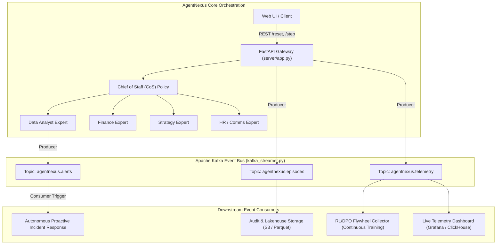

# 🚀 AgentNexus: Kafka Integration & Interview Guide

This guide gives you everything you need to **understand**, **demonstrate**, and **confidently explain** the Apache Kafka integration in AgentNexus during your interviews.

---

## 🎯 1. The 30-Second Interview Pitch

> *"In AgentNexus, our Chief of Staff (CoS) reinforcement-learning policy routes complex business tasks across Data Analyst, Finance, Strategy, and HR agents.*
> 
> *To prepare the system for enterprise-scale deployment, I integrated **Apache Kafka** as an asynchronous event-driven telemetry and alerting backbone:*
> 1. ***Decoupled Telemetry & Audit Stream:** Every episode reset, agent action (`consult`, `summarize`, `submit`), reward, and generated briefing is streamed in real time to Kafka. This provides an immutable audit log, feeds live observability dashboards, and serves as an event-sourcing flywheel for RL/DPO training datasets.*
> 2. ***Proactive Event-Driven Alerting:** When the Data Analyst detects anomalies or data quality drops below threshold, it emits a high-priority alert to a Kafka topic. An autonomous consumer intercepts this alert and triggers the Chief of Staff orchestrator to proactively launch a risk or crisis briefing before human intervention.*
> 3. ***Fault-Tolerant Dual-Mode Design:** Built with a resilient fallback mechanism—if a Kafka broker is running, it connects via real Kafka; if offline, it gracefully falls back without breaking tests or application startup."*

---

## 🛠 2. System Architecture



---

## 📬 3. Kafka Topics & Schemas

| Topic | Purpose | Partition Key | Sample Event |
| :--- | :--- | :--- | :--- |
| `agentnexus.episodes` | Lifecycle events (task reset, submit, completion). | `episode_id` | `{"event_type": "EPISODE_RESET", "task": "easy_brief", ...}` |
| `agentnexus.telemetry` | Granular per-step action, reward, and observation data. | `episode_id` | `{"step_count": 2, "action": "consult:finance", "reward": 0.08, ...}` |
| `agentnexus.alerts` | Anomaly detection, corruption spikes, and data-quality warnings. | `source` | `{"alert_type": "CORRUPT_TRANSACTION_BURST", "severity": "HIGH", ...}` |

### Why Partition by `episode_id`?
Kafka guarantees message ordering **within a partition**. By setting the message key to `episode_id`, all sequential steps (`step 1 -> step 2 -> step 3`) for the same episode always land on the same partition. This ensures consumers process the agent's actions in strict chronological order.

---

## 💻 4. How to Demo It (Live)

### Option A: Run the interactive demo script (Instant, No Docker required)
```bash
python3 scripts/kafka_demo.py
```
This runs an end-to-end multi-agent episode, publishes telemetry, and simulates the proactive alert consumer in real time!

### Option B: Test via REST API endpoints
Start the server:
```bash
python3 -m uvicorn server.app:app --port 7860
```
Then inspect via curl or Swagger docs at `http://localhost:7860/docs`:
* `GET /kafka/status` — Checks broker connection status and event buffer.
* `GET /kafka/events` — Inspects recently published events.
* `POST /kafka/alert` — Fires a test proactive anomaly event.

### Option C: Run with Real Apache Kafka (Docker)
1. Start Kafka (KRaft mode, no ZooKeeper needed):
   ```bash
   docker compose -f docker-compose.kafka.yml up -d
   ```
2. Set environment variable:
   ```bash
   export KAFKA_BOOTSTRAP_SERVERS="localhost:9092"
   ```
3. Run the demo or server:
   ```bash
   python3 scripts/kafka_demo.py
   ```

---

## 🎓 5. Top 5 Interview Questions & Ready Answers

### Q1: Why use Apache Kafka instead of RabbitMQ or Redis Pub/Sub?
> **Answer:** 
> *"Redis Pub/Sub is fire-and-forget—if a consumer is down, messages are lost. RabbitMQ excels at transient task queuing, but deletes messages once acknowledged.*
> *In contrast, Kafka is a distributed, persistent commit log. In AgentNexus, agent telemetry needs to be replayed for auditability, telemetry dashboards, and offline RL trajectory extraction (DPO/GRPO training). Kafka allows multiple independent consumer groups to read the same stream at their own pace without message loss."*

### Q2: How did you ensure message ordering in Kafka?
> **Answer:** 
> *"Kafka guarantees ordering only within a single partition. Since a multi-agent episode has strict step dependencies (e.g. consult analyst -> consult finance -> summarize -> submit), we assign the `episode_id` as the Kafka message key. This guarantees all steps for a given episode map to the exact same partition, preserving sequence integrity."*

### Q3: What happens if the Kafka cluster goes down? Does the agent system crash?
> **Answer:** 
> *"No, we designed the streamer with a fault-tolerant circuit breaker / fallback pattern. If the Kafka cluster is unreachable or timeouts exceed the threshold, the producer logs the anomaly and writes to an append-only fallback log (`cache/kafka_events.jsonl`). The core multi-agent execution and user-facing endpoints continue operating with zero disruption."*

### Q4: How does Kafka connect to the Reinforcement Learning (RL) pipeline?
> **Answer:** 
> *"During RL training (GRPO / DPO), we need large sets of execution trajectories: `(observation, action, reward, next_observation)`. Rather than relying on manual file dumps, the Kafka telemetry stream functions as a real-time data flywheel. An offline collector consumes from `agentnexus.telemetry`, pairs high-reward completions with low-reward completions, and compiles automated preference datasets for DPO fine-tuning."*

### Q5: How does the proactive anomaly trigger work?
> **Answer:** 
> *"Instead of relying solely on a human user to start an investigation, the Data Analyst module can emit an alert event to `agentnexus.alerts` when `data_quality_score` falls below threshold. A lightweight background Kafka consumer listens to this topic and automatically initiates a Chief of Staff incident brief (`risk_brief` or `crisis_brief`), demonstrating proactive, event-driven agent orchestration."*
