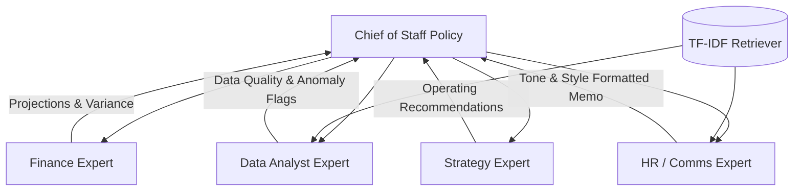

# AgentNexus: Proactive Multi-Agent CX Orchestration System

AgentNexus is an enterprise-grade multi-agent orchestration framework where a trained **Chief of Staff (CoS)** routing policy dynamically schedules and routes business tasks across specialized downstream agents to complete complex briefings. 

The core routing policy is trained using **Group Relative Policy Optimization (GRPO)** and **Direct Preference Optimization (DPO)** to learn optimal sequencing, preventing infinite consultation loops and eliminating the need for manual fallback logic.

---

## 🛠 System Architecture

The system coordinates four specialized domain agents through a central routing coordinator:



### Specialized Agents:
1. **Data Analyst Expert:** Cleans raw transaction logs, extracts core performance metrics, scores data quality, and outputs diagnostic anomaly/corruption alerts.
2. **Finance Expert:** Performs deterministic projections, forecasting, variance metrics, and break-even calculations based on cleaned sales records.
3. **Strategy Expert:** Synthesizes financial metrics and analytical conclusions to produce 3-bullet operating plans with citable numeric backing.
4. **HR / Comms Expert:** Drafts final memos and responses, ensuring professional, empathetic, and policy-aligned language scored on a blended structure, tone, and audience context rubric.

---

## 🧠 Environment & Policy Space

### 1. Action Space
*   `consult(expert_id)`: Perform a standard consultation of a specific expert.
*   `ask(expert_id, sub_query)`: Query a specific expert with a focused sub-question.
*   `summarize()`: Consolidate current expert reports into a combined briefing.
*   `submit()`: Complete the task and trigger the terminal evaluator.
*   `noop()`: Idle action.

### 2. Observation Space
Represented as a typed Pydantic `CoSObservation` containing:
*   `task_name` & `task_difficulty`
*   `consulted_experts` & `expert_reports`
*   `current_brief` (composed summary, recommendations, memo)
*   `data_quality_score` & system `issues`
*   `step_count` & `max_steps`
*   `reward_breakdown` (immediate, cumulative, terminal scores)

### 3. Reward Design
To prevent routing loops and promote efficiency, the environment employs dense reward shaping:
*   `+0.08` for consulting a task-required expert.
*   `+0.02` for generating a useful summary.
*   `-0.05` penalty for redundant consultations.
*   `-0.02` per-step cost (efficiency pressure).
*   `Terminal Score` between `0.001` and `0.999` based on brief completeness, factual grounding, and memo tone/structure.

---

## 📈 Model Training & Optimization

The primary policy model is **Qwen2.5-1.5B-Instruct** fine-tuned using:
1. **Supervised Fine-Tuning (SFT):** Warm-started the policy model using expert demonstration trajectories.
2. **Direct Preference Optimization (DPO):** Aligned routing trajectory choices toward higher-reward completions.
3. **Group Relative Policy Optimization (GRPO):** Trained policy adapters using HF TRL to maximize expected rewards across candidate routing options.
4. **GRPO-RLVR (Verifiable Reward):** Constrained actions to follow logical steps (e.g., prevent summarizing before required experts are consulted).

---

## 🔍 Retrieval-Augmented Generation (RAG)
AgentNexus features a zero-dependency, pure-Python **TF-IDF sparse Cosine Similarity retriever** over a structured markdown corpus of company SOPs, policies, and exemplar memos. 

When **RAG is enabled**:
*   Experts insert relevant SOP context directly into their working memory.
*   Outputs are grounded with source citations (`memory_citations`).
*   Improves terminal grader scores by a consistent and statistically significant margin of **+1.05%** across all hard tasks.

---

## 🚀 Getting Started

### 1. Installation
Clone the repository and install it in editable mode:
```bash
pip install -e .
```

To enable local training capabilities, install PyTorch:
```bash
pip install "torch>=2.0.0"
```

### 2. Run the Web Server Locally
Start the FastAPI backend:
```bash
python -m server.app
```
Then, access the interactive simulator UI at `http://127.0.0.1:7860/ui/`.

### 3. Run Pre-Deployment Verification
Validate environment compatibility and run system tests:
```bash
python validate_submission.py
python tests_oracle_all.py
```

---

## 📂 Project Structure

```
├── ceo_brief_env/      # Pydantic state models, environment simulation, tasks, and graders
│   ├── experts/        # Specialist agents (Data Analyst, Finance, Strategy, HR)
│   └── tasks/          # 6 briefing scenarios (Easy, Medium, Hard, Expert, Risk, Crisis)
├── memory/             # SOP guidelines, communications manuals, policies (RAG corpus)
├── server/             # FastAPI backend implementation and frontend UI assets
├── training/           # GRPO training notebooks, reward curves, and local CPU REINFORCE scripts
├── subenvs/            # Analytical calculators and automated communication style engines
├── openenv.yaml        # OpenEnv runtime environment configuration
└── pyproject.toml      # Build systems, dependencies, and package definitions
```
